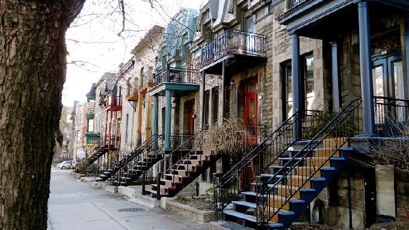

*Property Whispers is Gevitha's real estate journal for Laval and Greater Montreal.*

Greater Montreal's housing market is moving at a different pace this fall. Buyers have more properties to consider, while sellers must be more precise about pricing and presentation. Here is this week's essential market intelligence, practical guidance and home deals.

## Market watch

Fewer sales, more listings, and a median price that is still slightly higher than a year ago:

- **3,252 sales** in October 2026, down 18%
- **21,817 active listings**, up 18%
- **$640,000** median selling price for a single-family home, up 2%

QPAREB reports 3,252 sales in October 2026 (−18%) and 21,817 active listings (+18%) compared with October 2025. Yet the median selling price of a single-family home reached $640,000 (+2%). Fewer transactions do not mean every property is losing value: each neighbourhood and property segment has its own dynamics.

### Median sold prices, Montreal CMA, October 2026

| Property type | Median sold | Year over year | Days on market |
| --- | --- | --- | --- |
| Single-family | $640,000 | +2% | 36 |
| Condo | $430,500 | stable | 56 |
| Plex (2 to 5 units) | $850,000 | stable | 46 |

These are recorded median selling prices, not asking prices on property listings.

## Local lens: Laval

Inventory has expanded in Laval, giving buyers more to compare. But Sainte-Rose, Vimont and Chomedey should not be treated as one market. A renovated house, a condo and a plex require different benchmarks. **A sound comparable is a recent sale of a genuinely similar property.**

**What matters?**

- **Sellers:** study recent local sales and invest in strong listing photos.
- **Buyers:** compare total ownership costs, property condition and financing, not just the asking price.

## The homeowner's desk

### The news brief

The Bank of Canada increased its policy rate to **2.50% on October 28**. On November 10, it published a summary of the deliberations behind that decision. For households, the message is clear: mortgage affordability and monthly financial flexibility matter as much as purchase price.

### Readers ask

**Are prices falling everywhere?**
No. Median prices depend on property type and location. Review your own neighbourhood and recent comparable sales.

**Is this a good time to buy?**
There is more choice, but mortgage pre-approval and a property inspection remain essential.

**Should I renovate before listing?**
Not always. Start with visible repairs, lighting and thoughtful presentation before committing to major work.

### Home tip of the week

Before winter showings, refresh carpets, clear the entryway, check outdoor lighting and address small signs of moisture. Targeted maintenance may be more valuable than a costly renovation.

### Home deals: this week's picks

- Canadian Tire: Bissell Little Green ProHeat Pet cleaner for **$99.99** (previously $149.99, advertised 33% off).
- Canadian Tire: Frigidaire 33-lb/day countertop ice maker for **$179.99** (previously $269.99), promotion shown through November 18, 2026.

Prices seen on promotional pages; confirm stock, taxes and conditions before purchase. [Browse offers](https://www.canadiantire.ca/fr/promotions/offres-de-semaine.html)

### My RE/MAX discounts: how to register

1. Create a free account on **Mon RE/MAX**.
2. Browse offers from participating home-related partners.
3. Use the code or the method specified for each offer: online, in store or by appointment. Discounts vary by partner.

[monremax.remax-quebec.com](https://monremax.remax-quebec.com/) · [Program details](https://www.remax-quebec.com/fr/mes-rabais-remax)

> "The best investment in your home is not always the most expensive one. It is the one that solves a real need."

## In next week's edition

If you had $10,000 to spend before selling, would you choose the kitchen, the bathroom or the repairs no one sees? We explore the priorities.

**Thinking of selling? [Request your free home evaluation](/en/valuation/).**

Gevitha Kunaratnam · 514-570-2152 · info@gevithakunaratnam.ca

*Sources: QPAREB, October 2026 statistics (Nov. 6) · Bank of Canada (Oct. 28, Nov. 10) · Canadian Tire promotion pages checked Nov. 15 · RE/MAX Québec, My RE/MAX Discounts. See also [APCIQ](https://apciq.ca/rmr-de-montreal-le-ralentissement-des-ventes-persiste/), [Bank of Canada](https://www.banqueducanada.ca/grandes-fonctions/politique-monetaire/taux-directeur/), [RE/MAX Québec](https://www.remax-quebec.com/fr/mes-rabais-remax) and [Canadian Tire](https://www.canadiantire.ca/fr/promotions/a-vos-marques-prets-economisez/maison.html).*
