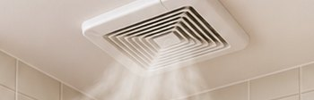

*The Real Estate Update (Le Point Immobilier), by Gevitha Kunaratnam, residential and commercial real estate broker, RE/MAX 2000.*

**In this edition:**

- market report
- home topic of the week
- practical tips
- quote
- Tranquilli-T
- frequently asked questions

## Market snapshot

*Greater Montreal, Q3 2026, Centris*

- **$812,000**: median price (single-family), up 2%
- **3,344**: total sales, down 13%
- **10,490**: active listings, up 12%
- **67 days**: average time to sell

## The market in one table

| Property type | Area | Median price | Sales | Days on market | Active listings |
| --- | --- | --- | --- | --- | --- |
| Single-family | Island of Montreal | $812,000 | 1,002 | 51 | 2,162 |
| Single-family | Laval | $630,000 | 547 | 36 | 792 |
| Condo | Island of Montreal | $477,000 | 1,728 | 67 | 6,696 |
| Condo | Laval | $439,999 | 236 | 57 | 623 |
| Plex (2 to 5 units) | Island of Montreal | $880,000 | 61 | 40 | 135 |
| Plex (2 to 5 units) | Laval | $463,500 | 100 | 75 | 351 |

## Home topic of the week

### Condensation and humidity in winter: getting to the bottom of the problem

Winter condensation can be normal, but persistent humidity can damage the home and affect indoor air quality.

### Why does condensation form?

- It appears when warm, humid indoor air meets a cold surface, such as a window.
- The water vapour in the air then cools and turns into droplets of water on the surface.

### The role of temperature and humidity

- The warmer and more humid the indoor air, the higher the risk of condensation.
- Cold surfaces (windows, exterior walls, corners) encourage condensation.

### Common sources of humidity in the home

- Daily activities: showers, baths, cooking, washing and drying laundry.
- Occupancy: breathing and the activities of the occupants add moisture to the air.
- Water infiltration or small leaks: roof, foundation, plumbing or joints.

### Signs it may be a more serious problem

- Frequent, heavy condensation, day after day.
- Damp stains, mould or musty smells.
- Peeling paint, deteriorating walls or warping wood.
- Constantly high humidity (often above 60%).

### Why ventilation, insulation and air circulation are essential

- Ventilation removes excess humidity and renews the indoor air.
- Good insulation keeps surfaces warmer, which reduces condensation.
- Adequate air circulation (interior doors open, furniture slightly away from walls, air vents unblocked) helps keep the air healthier and drier.

### Good ventilation

An efficient exhaust fan removes excess humidity, especially in the bathroom.

### Monitor the humidity

A hygrometer helps you keep an optimal humidity level at home (between 30% and 50% in winter).

> "A healthy home starts with healthy air and well-controlled humidity."

### What to check at home

- The humidity level: ideally between 30% and 50% in winter.
- Condensation on the windows, especially in the morning.
- That the bathroom and kitchen fans work properly.
- The condition of the insulation in the windows and the attic, to avoid heat loss.
- Air circulation in the home (aired-out rooms, unobstructed air vents).

### Why it matters before selling

Humidity problems can worry buyers, because they raise questions about general upkeep and possible repair costs. A dry, well-ventilated home with no signs of moisture inspires confidence and keeps a better perceived value on the market.

## Frequently asked questions

**Is the Montreal market still favourable to sellers?**
Yes. Demand remains present, but it is essential to set a fair price and rely on good marketing.

**How long should I plan to sell?**
The timeline varies by area, property type and price. In general, plan for 4 to 8 weeks in Greater Montreal.

**Should I renovate before listing?**
Not necessarily. Targeted improvements are often enough to maximize the appeal and value of your property.

## Tranquilli-T and My RE/MAX Discounts

**Tranquilli-T**: additional protection in certain transactions, subject to conditions. Offered in partnership with Gallagher. [See the details](https://www.remax-quebec.com/fr/tranquilli-t)

**My RE/MAX Discounts**: discounts and benefits from partners, subject to the applicable conditions. [See the details](https://www.remax-quebec.com/fr/mes-rabais-remax)

- Protection subject to conditions
- Fewer surprises
- Benefits for the home

## Practical tips before listing

- **Presentation:** keep the property clean, bright and decluttered.
- **Small repairs:** fix the visible items (handles, faucets, etc.).
- **Key documents:** have on hand the certificate of location, invoices for work done and information about the property.
- **Realistic price:** rely on market data and recent comparable sales.

> "Informed decisions protect your transaction better than rushed ones."

**Let's talk about your real estate project.** [Request your free home evaluation](/en/valuation/) or [write to me](/en/contact/).

Gevitha Kunaratnam · 514-570-2152 · info@gevithakunaratnam.ca · www.gevithakunaratnam.ca

**Next issue's question:** which renovations are really worth it before selling?

*Market data source: Centris, Q3 2026.*
