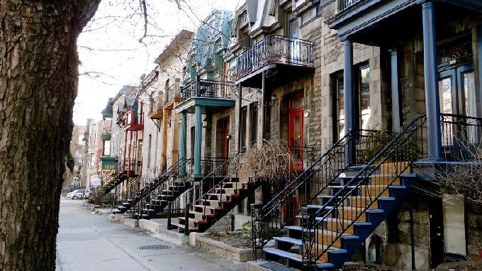

*Property Whispers est le journal immobilier de Gevitha pour Laval et le Grand Montréal.*

Le marché immobilier du Grand Montréal avance à un autre rythme cet automne. Les acheteurs ont plus de propriétés à comparer, et les vendeurs doivent être plus précis sur le prix et la présentation. Voici l'essentiel de la semaine : chiffres du marché, conseils pratiques et aubaines pour la maison.

## Le marché en bref

Moins de ventes, plus d'inscriptions, et un prix médian encore un peu plus élevé qu'il y a un an :

- **3 252 ventes** en octobre 2026, en baisse de 18 %
- **21 817 inscriptions actives**, en hausse de 18 %
- **640 000 $** de prix de vente médian pour une unifamiliale, en hausse de 2 %

La QPAREB rapporte 3 252 ventes en octobre 2026 (−18 %) et 21 817 inscriptions actives (+18 %) par rapport à octobre 2025. Pourtant, le prix de vente médian d'une unifamiliale a atteint 640 000 $ (+2 %). Moins de transactions ne veut pas dire que chaque propriété perd de la valeur : chaque quartier et chaque type de propriété a sa propre dynamique.

### Prix de vente médians, RMR de Montréal, octobre 2026

| Type de propriété | Prix médian vendu | Variation annuelle | Jours sur le marché |
| --- | --- | --- | --- |
| Unifamiliale | 640 000 $ | +2 % | 36 |
| Copropriété | 430 500 $ | stable | 56 |
| Plex (2 à 5 logements) | 850 000 $ | stable | 46 |

Il s'agit des prix de vente médians enregistrés, et non des prix demandés dans les inscriptions.

## Regard local : Laval

L'inventaire a augmenté à Laval, ce qui donne plus de choix aux acheteurs. Mais Sainte-Rose, Vimont et Chomedey ne forment pas un seul marché. Une maison rénovée, une copropriété et un plex demandent des points de comparaison différents. **Une bonne comparable est une vente récente d'une propriété vraiment semblable.**

**Ce qui compte**

- **Vendeurs :** étudiez les ventes locales récentes et investissez dans de belles photos pour votre inscription.
- **Acheteurs :** comparez le coût total de possession, l'état de la propriété et le financement, pas seulement le prix demandé.

## Le coin du propriétaire

### Nouvelle de la semaine

La Banque du Canada a relevé son taux directeur à **2,50 % le 28 octobre**. Le 10 novembre, elle a publié un résumé des délibérations qui ont mené à cette décision. Pour les ménages, le message est clair : l'abordabilité hypothécaire et la marge de manœuvre mensuelle comptent autant que le prix d'achat.

### Vos questions

**Les prix baissent-ils partout ?**
Non. Les prix médians dépendent du type de propriété et de l'endroit. Regardez votre propre quartier et les ventes comparables récentes.

**Est-ce le bon moment pour acheter ?**
Il y a plus de choix, mais la préautorisation hypothécaire et l'inspection préachat restent essentielles.

**Dois-je rénover avant de vendre ?**
Pas toujours. Commencez par les réparations visibles, l'éclairage et une présentation soignée avant de vous engager dans de gros travaux.

### Conseil maison de la semaine

Avant les visites d'hiver, rafraîchissez les tapis, dégagez l'entrée, vérifiez l'éclairage extérieur et réglez les petits signes d'humidité. Un entretien ciblé vaut parfois mieux qu'une rénovation coûteuse.

### Aubaines pour la maison : les choix de la semaine

- Canadian Tire : nettoyeur Bissell Little Green ProHeat Pet à **99,99 $** (auparavant 149,99 $, rabais annoncé de 33 %).
- Canadian Tire : machine à glaçons de comptoir Frigidaire de 33 lb/jour à **179,99 $** (auparavant 269,99 $), promotion affichée jusqu'au 18 novembre 2026.

Prix vus sur les pages promotionnelles ; confirmez la disponibilité, les taxes et les conditions avant d'acheter. [Voir les offres](https://www.canadiantire.ca/fr/promotions/offres-de-semaine.html)

### Mes rabais RE/MAX : comment s'inscrire

1. Créez un compte gratuit sur **Mon RE/MAX**.
2. Parcourez les offres des partenaires liés à la maison.
3. Utilisez le code ou la méthode indiquée pour chaque offre : en ligne, en magasin ou sur rendez-vous. Les rabais varient selon le partenaire.

[monremax.remax-quebec.com](https://monremax.remax-quebec.com/) · [Détails du programme](https://www.remax-quebec.com/fr/mes-rabais-remax)

> « Le meilleur investissement dans votre maison n'est pas toujours le plus coûteux : c'est celui qui répond à un vrai besoin. »

## Dans l'édition de la semaine prochaine

Si vous aviez 10 000 $ à dépenser avant de vendre, choisiriez-vous la cuisine, la salle de bain ou les réparations que personne ne voit ? Nous explorons les priorités.

**Vous pensez vendre ? [Demandez votre évaluation gratuite](/fr/evaluation/).**

Gevitha Kunaratnam · 514-570-2152 · info@gevithakunaratnam.ca

*Sources : QPAREB, statistiques d'octobre 2026 (6 nov.) · Banque du Canada (28 oct., 10 nov.) · pages promotionnelles de Canadian Tire consultées le 15 nov. · RE/MAX Québec, Mes rabais RE/MAX. Voir aussi [APCIQ](https://apciq.ca/rmr-de-montreal-le-ralentissement-des-ventes-persiste/), [Banque du Canada](https://www.banqueducanada.ca/grandes-fonctions/politique-monetaire/taux-directeur/), [RE/MAX Québec](https://www.remax-quebec.com/fr/mes-rabais-remax) et [Canadian Tire](https://www.canadiantire.ca/fr/promotions/a-vos-marques-prets-economisez/maison.html).*
